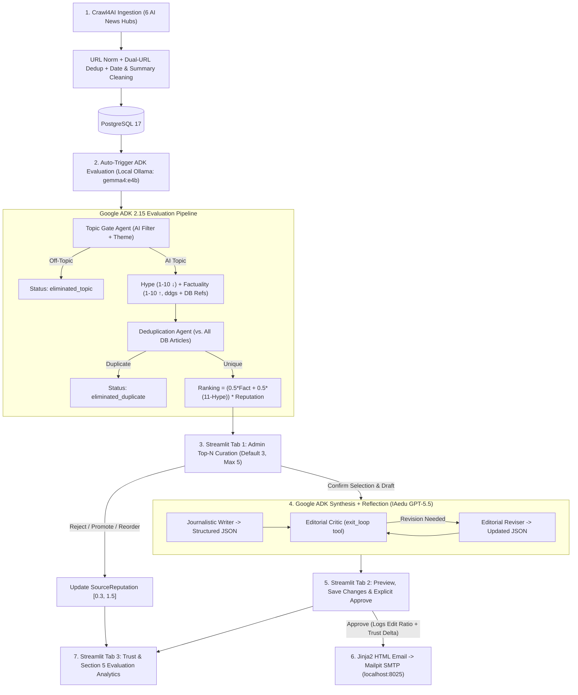

# AI News Newsletter Generator

**LLM-based Multi-Agent Orchestration System with Human-in-the-Loop (HitL) Curation & Dynamic Source Reputation**

> Developed for the **Human-Centered Artificial Intelligence (IACH)** course — Master in Artificial Intelligence and Data Science, Faculty of Sciences and Technology, University of Coimbra (FCTUC).  
> **Authors:** Pedro Silva, Sara Guedes, Mariana Barradas.

---

## Table of Contents

1. [Project Overview & Objectives](#1-project-overview--objectives)
2. [System Architecture & Hybrid LLM Strategy](#2-system-architecture--hybrid-llm-strategy)
3. [Repository Structure](#3-repository-structure)
4. [Phase 1 — Automated Ingestion & Cleaning Pipeline](#4-phase-1--automated-ingestion--cleaning-pipeline)
5. [Phase 2 — Multi-Agent Article Classification & Auditing (Google ADK)](#5-phase-2--multi-agent-article-classification--auditing-google-adk)
6. [Ranking Formula & Dynamic Source Reputation Model](#6-ranking-formula--dynamic-source-reputation-model)
7. [Newsletter Generation, Reflection Loop & Email Delivery](#7-newsletter-generation-reflection-loop--email-delivery)
8. [Human-in-the-Loop (HitL) Workflow & Admin Dashboard](#8-human-in-the-loop-hitl-workflow--admin-dashboard)
9. [Evaluation Methodology & Metrics](#9-evaluation-methodology--metrics)
10. [Database Schema (PostgreSQL 17)](#10-database-schema-postgresql-17)
11. [REST API Reference](#11-rest-api-reference)
12. [Environment Variables & Configuration](#12-environment-variables--configuration)
13. [How to Run (Docker + Local Ollama GPU Setup)](#13-how-to-run-docker--local-ollama-gpu-setup)
14. [Refinements Relative to the Initial Proposal](#14-refinements-relative-to-the-initial-proposal)

---

## 1. Project Overview & Objectives

The rapid growth of daily AI publications has created an overwhelming stream of sensationalist headlines, unverified projections (*hype*), duplicate coverage, and marketing noise. Relying on a single unguarded LLM to summarize news risks hallucinations, hype amplification, and factual errors.

This project implements an end-to-end **Trustworthy, Human-Centered Multi-Agent System** grounded in computational trust/reputation models (*Marsh*, *ReGReT*, *Rosário, Macedo & Cardoso*) and explainable multi-agent disinformation analysis (*Mattia*). It achieves three core goals:

1. **Hype & Misinformation Filtering:** Decomposes quality assessment into specialized LLM agents (`Topic`, `Hype`, `Factuality`, `Deduplication`) that produce structured JSON scores and plain-English justifications for full explainability.
2. **Trustworthy Ranking & Dynamic Reputation:** Ranks stories using an explicit mathematical model combining factuality, hype penalization, and a dynamic **Source Trust Multiplier** that adapts over time from Human-in-the-Loop editorial decisions.
3. **High-Quality Journalistic Synthesis:** Uses a **Writer + Critic/Reviser Reflection Loop** to produce clean, hype-free, publication-ready English newsletters delivered as responsive HTML emails (with zero internal AI metrics exposed to readers).

---

## 2. System Architecture & Hybrid LLM Strategy



### Hybrid LLM Architecture (Why Two Providers?)

The orchestration layer uses **Google ADK (`google-adk==2.15.0`)** with a split-provider routing design configurable via `.env`:

| Pipeline Role | Default Provider & Model | ADK Connector | Rationale |
|---|---|---|---|
| **Article Evaluation** (`Topic`, `Hype`, `Factuality`, `Deduplication`) | **Local Ollama — `gemma4:e4b`** (host GPU via `host.docker.internal:11434/v1`) | `google.adk.models.lite_llm.LiteLlm` (`temperature=0`, `reasoning_effort="none"`) | High call volume (4 LLM calls per article). Running locally on an RTX 4060 GPU avoids external API `429` rate limits, costs €0, and runs 100% on GPU (`~0.38s` warm latency). |
| **Newsletter Writing & Reflection** (`Writer`, `Critic`, `Reviser`) | **FCT/FCCN IAedu — OpenAI `GPT-5.5`** (`api.iaedu.pt`) | Custom `IAeduLlm(BaseLlm)` (`backend/api/services/agents/iaedu_llm.py`) | Low call volume (2–4 calls per edition). Leverages institutional FCT/FCCN GPT-5.5 for top-tier journalistic prose while respecting academic usage limits. |

#### How Custom `IAeduLlm(BaseLlm)` Works
Because IAedu does not expose a native OpenAI `/v1/chat/completions` JSON endpoint, `IAeduLlm` subclasses Google ADK's `BaseLlm`:
- Sends `POST` requests as `multipart/form-data` with header `x-api-key`, `channel_id`, `user_info="{}"`, and a **fresh `uuid4` `thread_id`** per call to keep every agent turn stateless and free of cross-article context leakage.
- Parses IAedu's newline-delimited JSON event stream (`type: "start" | "token" | "message" | "error"`), preferring the authoritative final `message` payload with token concatenation fallback.
- Includes a **JSON Tool-Call Bridge**: when an ADK agent declares tools (such as `exit_loop` on `editorial_critic`), `IAeduLlm` injects the tool specification into the prompt and translates `{"tool_call": {"name": "exit_loop", "args": {}}}` responses back into native ADK `types.Part.from_function_call(...)` events.
- Retries transient failures up to `3` times with linear backoff (`1.5s * attempt`).

---

## 3. Repository Structure

The project uses a modular monorepo with 5-stage non-root Docker builds (`python:3.11.6-slim`, `uv 0.12.17`) orchestrated via Docker Compose `include:`.

```text
AI-News-Newsletter-Generator/
├── docker-compose.yml                         # Root Compose orchestrating backend + frontend via include:
├── README.md
├── docs/
│   ├── Project_Proposal-AI_News_Newsletter.pdf
│   └── tutorials/DSPT-AgenticAI/              # Google ADK 2.x design patterns reference
│
├── backend/
│   ├── Dockerfile                             # 5-stage build (base, dependencies, tools, build, runtime)
│   ├── docker-compose.yml                     # Services: db (Postgres 17), crawl4ai (0.9.4), mailpit (v1.24), api
│   ├── pyproject.toml & uv.lock               # Frozen dependency lock (FastAPI, SQLAlchemy, google-adk, litellm, ddgs, jinja2)
│   ├── .env.example / .env
│   ├── tests/test_phase2.py                   # Unit tests for IAedu stream parser, ranking math & HTML hygiene
│   └── api/
│       ├── main.py                            # FastAPI entrypoint, CORS, lifespan init_db()
│       ├── configs/
│       │   ├── config.py                      # Typed Pydantic BaseSettings
│       │   ├── database.py                    # SQLAlchemy pool & Base.metadata.create_all()
│       │   ├── logging.py                     # Centralized logging (suppresses primp/ddgs/LiteLLM noise)
│       │   └── sources.py                     # Strict HTTPS news hub definitions & regex filters
│       ├── models/
│       │   ├── entities/                      # ORM models: article, article_evaluation, source_reputation, newsletter
│       │   └── dtos/                          # Pydantic v2 schemas: article, evaluation, newsletter
│       ├── routers/                           # Modular routers: home, health, articles, agents, newsletters
│       └── services/
│           ├── ingestion/                     # crawl4ai_client, crawler_service, date_parser, url_utils
│           ├── agents/
│           │   ├── iaedu_llm.py               # Custom BaseLlm for IAedu + LiteLlm Ollama factory
│           │   ├── verification_tools.py      # Paced DuckDuckGo (ddgs) search + DB corroboration & dedup selector
│           │   ├── evaluation_pipeline.py     # ADK Topic -> Hype/Factuality -> Deduplication workflow
│           │   ├── synthesis_pipeline.py      # ADK SequentialAgent + Reflection LoopAgent (Writer/Critic/Reviser)
│           │   └── prompts/templates.py       # Decoupled all-English strict JSON system prompts
│           ├── reputation_service.py          # Ranking math & HitL source trust updates
│           ├── email_service.py               # Jinja2 HTML + Markdown renderer & Mailpit SMTP sender
│           ├── templates/newsletter_email.html
│           └── newsletter_service.py          # Core orchestrator bridging DB, ADK, Reputation & Email
│
└── frontend/
    ├── Dockerfile                             # 5-stage build
    ├── docker-compose.yml                     # Service: frontend (Streamlit)
    ├── pyproject.toml & uv.lock
    ├── .env.example / .env
    └── app/
        ├── app.py                             # 3-tab Admin Editorial Dashboard
        ├── client.py                          # Backend HTTP client
        └── components/
            ├── article_card.py                # Curation card with score pills & explainability drawer
            └── newsletter_view.py             # Reader Preview, Save-Only Inline Editor, Approve & Mailpit Delivery
```

---

## 4. Phase 1 — Automated Ingestion & Cleaning Pipeline

Triggered via `POST /articles/ingest` (or the **"🚀 Fetch & Score Latest News"** button in Streamlit), ingestion runs in 6 steps and **automatically invokes the Phase 2 AI Evaluation Pipeline** on all newly ingested (and any pending unevaluated) articles:

### Configured News Sources (`backend/api/configs/sources.py`)
All patterns enforce strict HTTPS (`^https://`) and exclude top-level directory/index hubs:

| Source Name | Hub URL | Filtering Rules |
|---|---|---|
| **OpenAI News** | `https://openai.com/news/` | Matches `/index/<slug>` or `/news/<slug>`; excludes `/index/overview` |
| **Anthropic News** | `https://anthropic.com/news` | Matches `/news/<slug>`; excludes `/product`, `/announcements`, `/company`, `/research` |
| **Google DeepMind** | `https://deepmind.google/discover/blog/` | Matches `/blog/<slug>` or `/discover/blog/<slug>` |
| **Google AI Blog** | `https://blog.google/innovation-and-ai/models-and-research/` & `.../innovation-and-ai/` | Matches article subpaths under both hubs |
| **BBC AI News** | `https://www.bbc.com/news/topics/ce1qrvleleqt` | Matches BBC article URLs (`/news/articles/<id>`) discovered on the AI topic hub |
| **Hugging Face Blog** | `https://huggingface.co/blog` | Matches `/blog/<slug>`; excludes `/blog/community` |

### Cleaning & Deduplication Guarantees
1. **Crawl4AI Chrome Stripping:** Hub discovery crawls full pages, while individual article scraping passes `crawler_config={"excluded_tags": ["nav", "footer", "header", "aside", "form"], "remove_overlay_elements": True}` so LLMs receive pure article Markdown without navigation bars or footers. (`CRAWL4AI_ALLOW_INTERNAL_URLS="true"` prevents container Docker-network SSRF false positives in Crawl4AI `0.9.4`.)
2. **Dual-URL Pre-Deduplication:** Normalizes URLs (strips `utm_*`, `ref`, fragments, trailing slashes) and checks both `canonical_url` and `original_url` in PostgreSQL **before** scraping so redirected/vanity URLs are never re-scraped.
3. **Multi-Strategy Date Extraction (`date_parser.py`):** Checks HTML metadata keys, nested JSON-LD (`datePublished`, `dateCreated`, `dateModified`), `<time datetime="...">` tags, URL date slugs (`/YYYY/MM/DD/`, `/YYYY-MM-DD/`), US & European text formats (`October 23, 2026`, `23 October 2026`, `23-10-2026`), and relative expressions (`"3 hours ago"`, `"yesterday"`). Articles without a discoverable date (typically static landing pages) are skipped; articles older than `MAX_ARTICLE_AGE_DAYS=7` are filtered out.
4. **Smart Summary & Author Sanitization:** Caps summaries at **350 characters** on a word boundary (`...`), replaces generic publisher taglines (e.g., Hugging Face's site-wide motto) with the first substantive paragraph ($\ge 35$ chars) of the Markdown body, and defaults missing authors to `source.name`.

---

## 5. Phase 2 — Multi-Agent Article Classification & Auditing (Google ADK)

Every unevaluated article passes through a **3-stage Google ADK 2.15 pipeline** (`evaluation_pipeline.py`), returning strict Pydantic-validated JSON at each stage:

### Stage 1: Topic Gate Agent (`topic_gate_agent`)
- **Input:** Title, Source, Author, Date, Summary, and first **1,200 characters** of article Markdown.
- **Output Schema (`TopicAgentOutput`):**
  - `is_ai_topic` (`bool`): Binary relevance filter. Non-AI articles are immediately marked `status = "eliminated_topic"` (saving downstream audit & search calls).
  - `primary_theme` (`str`): Assigned to one of 7 editorial categories:
    - `LLMs & Reasoning`
    - `Autonomous Agents & Tools`
    - `AI Hardware & Infrastructure`
    - `AI Research & Science`
    - `AI Safety, Policy & Governance`
    - `Enterprise & Product AI`
    - `Off-Topic`
  - `reason` (`str`): 1–2 plain-English sentences justifying the classification.

### Stage 2: Hype & Factuality Auditors (`article_auditors`)
Runs as a **`SequentialAgent`** when using local Ollama (protecting single-GPU VRAM from parallel KV-cache contention) and as a **`ParallelAgent`** when using cloud APIs. Both agents receive Title, Metadata, Summary, and up to **4,500 characters** of clean article text.

1. **Hype Auditor (`hype_auditor` — `HypeAgentOutput`):**
   - Scores **`hype_score`** on a **`1` to `10` scale (lower is better)**:
     - `1–2`: Grounded engineering, peer-reviewed science, concrete benchmarks, transparent limitations.
     - `3–4`: Solid factual announcement with mild promotional framing.
     - `5–6`: Real news mixed with notable marketing spin or speculative projections.
     - `7–8`: Heavy hype, vague grandiose promises, or reliance on unverified future projections.
     - `9–10`: Clickbait, sensationalism, or unsubstantiated futurism.
   - Outputs `reason` citing concrete textual signals.

2. **Factuality Auditor (`factuality_auditor` — `FactualityAgentOutput`):**
   - Before invoking the agent, `gather_corroboration_evidence()` (`verification_tools.py`) collects:
     - Up to **3 independent external web references** via DuckDuckGo (`ddgs`, lock-paced at `0.85s` intervals, excluding self-URL).
     - Up to **3 lexically related articles** already stored in PostgreSQL (Jaccard token overlap on title + summary).
   - Scores **`factuality_score`** on a **`1` to `10` scale (higher is better)**:
     - `9–10`: Primary authoritative announcement or peer-reviewed paper corroborated by independent sources and concrete verifiable metrics.
     - `7–8`: Well-supported factual reporting aligned with external evidence.
     - `5–6`: Plausible reporting with limited corroboration.
     - `3–4`: Weakly supported claims, rumors, or contradictions.
     - `1–2`: Demonstrably false or fabricated.
   - Persists both `reason` and all `verification_sources` (`{title, url, snippet, origin}`) in PostgreSQL for Admin inspection.

### Stage 3: Deduplication Agent (`deduplication_agent`)
- **Input:** Candidate article metadata compared against **all existing articles in PostgreSQL** (every article when DB size $\le 25$; otherwise top `18` lexically overlapping + `7` most recent articles via `select_dedup_candidates()`).
- **Output Schema (`DeduplicationAgentOutput`):**
  - `is_duplicate` (`bool`): `true` only if another article covers the **exact same underlying announcement, launch, paper, or incident** (distinct announcements from the same company or Part I vs. Part II are preserved).
  - `duplicate_of_article_id` (`UUID | null`): Reference to the primary article.
  - `reason` (`str`): Plain-English explanation.
- Duplicate stories are persisted with `status = "eliminated_duplicate"` and moved to the Admin's **Filtered Out Stories** audit drawer.

---

## 6. Ranking Formula & Dynamic Source Reputation Model

### Ranking Calculation (`backend/api/services/reputation_service.py`)

Because `Hype` is **lower-is-better** (`1–10`) while `Factuality` is **higher-is-better** (`1–10`), `Hype` is first inverted to a positive **Groundedness** score on the same `1–10` scale:

$$\text{Groundedness} = 11 - \text{Hype}$$

The weighted quality sub-score uses equal default weights ($w_f = 0.5$, $w_h = 0.5$, configurable via `WEIGHT_FACTUALITY` and `WEIGHT_HYPE`):

$$\text{Weighted Sub-score} = w_f \cdot \text{Factuality} + w_h \cdot \text{Groundedness}$$

Finally, the sub-score is scaled by the source domain's live **Reputation Multiplier**:

$$\text{Ranking} = \text{Weighted Sub-score} \times \text{Reputation}$$

- **Theoretical Sub-score Range:** `[1.0, 10.0]`
- **Theoretical Final Ranking Range:** `[0.3, 15.0]` (given reputation bounds `[0.3, 1.5]`)
- **Live Recalculation:** `GET /agents/rankings` always recomputes `final_ranking_score` using each source's **current** reputation multiplier so any HitL feedback immediately re-ranks remaining candidates.
- **Top-N Shortlist:** Default `DEFAULT_TOP_N = 3` (recommended), adjustable by the Admin between `1` and `MAX_TOP_N = 5`. Any article whose evaluation has `status = "published"` (already sent in a prior newsletter) is automatically excluded from future Top-N suggestions.

### Dynamic Source Reputation Mechanics (HitL Feedback)

Every news source (`source_reputations` table) acts as an "oracle" whose reputation evolves iteratively with human editorial actions:

- **Initial Score:** `1.0` (`REPUTATION_DEFAULT=1.0`)
- **Clamped Bounds:** `[0.3, 1.5]` (`REPUTATION_MIN=0.3`, `REPUTATION_MAX=1.5`) — prevents a source from ever being zeroed out permanently or boosted unboundedly.
- **Audit Trail:** Every update appends `{timestamp, event, delta, new_score, article_title}` to the JSONB `history` column for time-series plotting.

| Human Editorial Action | Event Key | Reputation Delta ($\Delta$) | Trigger Point |
|---|---|---|---|
| **Approve story with zero text edits** | `accepted_untouched` | **`+0.05`** | Clicking `✅ Approve Edition` (once per edition) |
| **Promote / rescue story from outside Top N** | `promoted` | **`+0.05`** | Clicking `✍️ Confirm Selection & Draft Newsletter` |
| **Move Top-N story higher in rank** | `reordered_up` | **`+0.02`** | Clicking `✍️ Confirm Selection & Draft Newsletter` |
| **Approve story after manual copy edits** | `accepted_edited` | **`+0.01`** | Clicking `✅ Approve Edition` (once per edition) |
| **Move Top-N story lower in rank** | `reordered_down` | **`-0.02`** | Clicking `✍️ Confirm Selection & Draft Newsletter` |
| **Reject story from AI-recommended Top N** | `rejected_top_n` | **`-0.08`** | Clicking `✍️ Confirm Selection & Draft Newsletter` |

---

## 7. Newsletter Generation, Reflection Loop & Email Delivery

### Structured JSON Contract (`NewsletterStructuredContent`)
Once the human editor validates the shortlist (`1–5` stories), `POST /newsletters/draft` runs the **Google ADK Synthesis Pipeline** (`synthesis_pipeline.py`) powered by **IAedu GPT-5.5**.

To ensure clean inline editing, exact per-story edit measurement, and deterministic HTML formatting, the pipeline operates strictly on a **Structured JSON contract** (never passing internal hype/factuality/ranking scores to the writer):

```json
{
  "edition_title": "AI Pulse Digest",
  "subject": "Concise, hype-free subject line (<= 95 chars)",
  "intro": "2-3 sentence executive briefing of the edition.",
  "blurbs": [
    {
      "article_id": "<uuid>",
      "rank_order": 1,
      "theme": "AI Hardware & Infrastructure",
      "headline": "Grounded journalistic headline",
      "body": "Two concise, factual paragraphs (~90-140 words) grounded strictly in the source text.",
      "source_name": "OpenAI News",
      "source_url": "https://..."
    }
  ],
  "outro": "1-2 sentence editorial sign-off."
}
```

### ADK Writer + Reflection Loop (`SequentialAgent` + `LoopAgent`)
Mirroring the Agentic Reflection design pattern:
1. **`journalistic_writer` (`Agent`, `output_key="draft"`):** Drafts the complete Structured JSON from the human-approved articles (up to `5,500` chars per article).
2. **`editorial_reflection_loop` (`LoopAgent`, `max_iterations=3`):**
   - **`editorial_critic` (`Agent`, `tools=[exit_loop]`):** Verifies 5 strict criteria: (1) valid Structured JSON, (2) intact IDs/ranks/URLs, (3) objective hype-free English journalism, (4) **zero internal score leakage**, and (5) factual fidelity. Calls `exit_loop` immediately when all pass; otherwise outputs concrete revision feedback (`output_key="feedback"`).
   - **`editorial_reviser` (`Agent`, `output_key="draft"`):** Rewrites the JSON addressing every feedback item and loops back to the Critic.
3. **Defensive Post-Validation:** Re-enforces authoritative `article_id`, `rank_order`, `source_name`, and `source_url` from PostgreSQL before saving and rendering.

### HTML/Markdown Rendering & Mailpit Delivery (`email_service.py`)
- **Rendering:** Jinja2 renders `newsletter_email.html` into a responsive, inline-CSS, text-only HTML email (plus clean plain-text Markdown). Readers see the masthead, date, intro, ranked stories with theme pills and `"Read Original Article →"` buttons, and sign-off — **zero internal AI metrics**.
- **Test Dispatch (`test_email`):** Sends `[TEST] <subject>` to any address via Mailpit SMTP (`mailpit:1025`) without changing edition status or retiring articles.
- **Full Dispatch:** Sends multipart (`text/plain` + `text/html`) emails to all active rows in `subscribers`, marks the newsletter `status = "sent"`, and updates included articles' evaluations to `status = "published"` so they never reappear in future Top-N lists.
- **Inspection:** Every delivered email can be inspected live in the **Mailpit Web Inbox** at [http://localhost:8025](http://localhost:8025).

---

## 8. Human-in-the-Loop (HitL) Workflow & Admin Dashboard

The Streamlit UI ([http://localhost:8501](http://localhost:8501)) is designed strictly for an **Editorial Admin** (no UUIDs, no raw JSON dumps, no developer health monitors), organized into **3 tabs**:

1. **📰 Tab 1 — Editorial Curation:**
   - **One-click Ingestion + Auto-Scoring:** `🚀 Fetch & Score Latest News` crawls all 6 sources and automatically runs the ADK evaluation pipeline on unevaluated stories.
   - **Top-N Shortlist (`1–5`, default `3 Recommended`):** Displays ranked cards with color-coded metric pills (`Overall`, `Factuality`, `Hype`, `Source Trust`, `Theme`), expandable **"Why did our editors score it this way?"** rationales + clickable corroboration links, `Read Original Article ↗`, `⬆️ Move Up`, `⬇️ Move Down`, and `✖ Reject`.
   - **Candidate Pool & Audit Drawer:** Searchable/filterable pool with `➕ Add to Edition` rescue buttons, plus a collapsible **Filtered Out Stories** drawer explaining off-topic and duplicate eliminations.
   - **Draft CTA:** `✍️ Confirm Selection & Draft Newsletter` commits curation HitL deltas and triggers IAedu GPT-5.5 synthesis.

2. **✉️ Tab 2 — Newsletter Studio & Delivery:**
   - **Edition Archive Switcher:** Human-readable labels (`[DRAFT] / [APPROVED] / [SENT] YYYY-MM-DD — Subject`).
   - **👁️ Reader Preview:** Renders the exact HTML email subscribers will receive + Download HTML / Download Markdown buttons.
   - **✏️ Edit Draft (Two-Step Safety):**
     - `💾 Save Changes` (form submit / `Enter` / `Ctrl+Enter`) persists edits (`PATCH /newsletters/{id}`) and refreshes the preview **without approving**.
     - `✅ Approve Edition` (standalone button outside the form) explicitly approves the edition (`PATCH /newsletters/{id}/approve`), finalizes edit metrics, and applies acceptance reputation deltas.
   - **📨 Delivery & Subscribers:** Manage active subscribers in PostgreSQL, send safe test previews, dispatch approved editions, and jump straight to **Mailpit Inbox ↗**.

3. **📊 Tab 3 — Trust & Quality Analytics:**
   - Live KPIs for system evaluation (Section 9), **Source Trust Leaderboard** (bar chart + breakdown table), and **Source Trust Evolution** line chart over HitL steps.

---

## 9. Evaluation Methodology & Metrics

Aligned directly with **Section 5 of the Project Proposal**, system effectiveness is evaluated quantitatively by measuring **how little human correction is required** across editions:

| Metric | Stored Field | Exact Computation | Interpretation |
|---|---|---|---|
| **Top-N Acceptance Rate** | `hitl_metrics.top_n_retention_rate` | $\frac{|\text{Suggested Top } N \cap \text{Final Selected}|}{|\text{Suggested Top } N|}$ (averaged across editions) | High % = AI ranking aligns well with human editorial judgement. |
| **Ranking Reorder Rate** | `hitl_metrics.reordered` | Share of editions where the relative order of kept Top-N items was changed | Low % = AI relative priority ordering is accurate. |
| **Unedited Story Rate** | `hitl_metrics.unedited_items_ratio` | $\frac{\text{stories with zero edits to headline, theme, or body}}{N}$ (exact match against `ai_draft_snapshot`, no dead-zone) | High % = LLM journalistic copy is publication-ready as drafted. |
| **Avg Edit Intensity (%)** | `hitl_metrics.avg_edit_ratio` | $1 - \text{SequenceMatcher}(\text{AI full draft}, \text{Human final}).\text{ratio}()$ across masthead, subject, intro, all blurbs, and outro | Low % = Even when humans tweak text, edits are minor rather than full rewrites. |
| **Source Trust Evolution** | `source_reputations.history` | Timestamped trajectory of each source's multiplier (`[0.3, 1.5]`) | Demonstrates active learning & automatic penalization of lower-value sources. |

---

## 10. Database Schema (PostgreSQL 17)

Six normalized, auditable tables are initialized automatically on API startup (`Base.metadata.create_all()`):

1. **`articles`:** Scraped stories (`id` UUID PK, `source`, `canonical_url` unique/indexed, `original_url`, `title`, `summary`, `author`, `article` clean Markdown, `published_at`, `created_at`, `updated_at`).
2. **`article_evaluations`:** 1-to-1 explainable agent scores (`id`, `article_id` FK unique, `is_ai_topic`, `primary_theme`, `topic_reason`, `hype_score`, `groundedness_score`, `hype_reason`, `factuality_score`, `factuality_reason`, `verification_sources` JSONB, `is_duplicate`, `duplicate_of_article_id`, `dedup_reason`, `weighted_subscore`, `reputation_snapshot`, `final_ranking_score`, `status`, timestamps).
3. **`source_reputations`:** Domain trust registry (`source_name` PK, `reputation_score`, `accepted_count`, `rejected_count`, `edited_count`, `promoted_count`, `total_evaluated`, `history` JSONB, timestamps).
4. **`newsletters`:** Generated editions (`id`, `edition_title`, `subject`, `structured_content` JSONB, `full_markdown`, `full_html`, `status`, `selected_count`, `hitl_metrics` JSONB, `created_at`, `approved_at`, `sent_at`).
5. **`newsletter_items`:** Per-story draft vs. final audit (`id`, `newsletter_id` FK, `article_id` FK, `rank_order`, `theme`, `headline`, `source_name`, `source_url`, `ai_generated_body`, `human_approved_body`, `was_edited`, `edit_ratio`).
6. **`subscribers`:** Email recipients (`id`, `email` unique, `name`, `is_active`, `created_at`).

---

## 11. REST API Reference

Interactive OpenAPI docs are available at **[http://localhost:8000/docs](http://localhost:8000/docs)**.

| Method & Endpoint | Description |
|---|---|
| `GET /health` | Service healthcheck |
| `POST /articles/ingest` | Runs Crawl4AI ingestion across all 6 sources **and automatically evaluates all unevaluated articles** |
| `GET /articles?skip=0&limit=50` | Lists ingested articles ordered by `published_at DESC` |
| `POST /agents/evaluate` | Evaluates any pending unevaluated articles manually |
| `GET /agents/rankings?top_n=3` | Returns `recommended` (Top 1–5), `candidate_pool`, `eliminated`, and `unevaluated_count` (excludes `published` stories) |
| `GET /agents/analytics` | Returns live Source Reputations and Proposal Section 5 HitL KPIs |
| `POST /newsletters/draft` | Applies HitL curation deltas and drafts a Structured JSON newsletter via ADK Writer + Reflection |
| `GET /newsletters` / `GET /newsletters/{id}` | Lists editions or fetches a full edition (JSON, HTML, Markdown, items) |
| `PATCH /newsletters/{id}` | Saves inline draft edits **without** approving |
| `PATCH /newsletters/{id}/approve` | Explicitly approves an edition, finalizes edit metrics, and applies acceptance reputation deltas |
| `POST /newsletters/{id}/send` | Sends HTML email via Mailpit SMTP (single `test_email` or all active `subscribers`; retires published stories) |
| `GET / POST / DELETE /newsletters/subscribers` | Manages active email subscribers |

---

## 12. Environment Variables & Configuration

All variables are defined in `backend/.env.example`, `frontend/.env.example`, `backend/api/configs/config.py`, and the `docker-compose.yml` files:

### Backend (`backend/.env`)

| Variable | Default | Purpose |
|---|---|---|
| `DATABASE_URL` | `postgresql+psycopg://postgres:postgres@db:5432/ai_news` | PostgreSQL 17 connection string |
| `CRAWL4AI_URL` / `CRAWL4AI_API_TOKEN` | `http://crawl4ai:11235` / `crawl4ai_secret_token` | Crawl4AI container endpoint & auth token |
| `MAX_ARTICLE_AGE_DAYS` | `7` | Lookback window for ingested articles |
| `CHATGPT_55_ENDPOINT` / `CHATGPT_55_API_KEY` / `CHATGPT_55_CHANNEL_ID` | *(from `chat.iaedu.pt`)* | FCT/FCCN IAedu GPT-5.5 API credentials |
| `EVAL_LLM_PROVIDER` | `ollama` | Evaluation model backend (`ollama` \| `iaedu`) |
| `WRITER_LLM_PROVIDER` | `iaedu` | Newsletter synthesis backend (`iaedu` \| `ollama`) |
| `OLLAMA_BASE_URL` | `http://host.docker.internal:11434/v1` | Host Ollama OpenAI-compatible URL |
| `OLLAMA_MODEL` | `gemma4:e4b` | Local Ollama model for Evaluation Agents |
| `OLLAMA_REASONING_EFFORT` | `none` | Disables slow chain-of-thought tokens during JSON scoring |
| `DEFAULT_TOP_N` / `MAX_TOP_N` | `3` / `5` | Default & max stories per newsletter |
| `WEIGHT_FACTUALITY` / `WEIGHT_HYPE` | `0.5` / `0.5` | Weights in the ranking sub-score formula |
| `REPUTATION_DEFAULT` / `MIN` / `MAX` | `1.0` / `0.3` / `1.5` | Initial source trust & clamping bounds |
| `AGENT_MAX_CONCURRENCY` | `1` | Max concurrent article evaluations (forced to `1` for local Ollama) |
| `REFLECTION_MAX_ITERATIONS` | `3` | Max Critic $\leftrightarrow$ Reviser rounds in `LoopAgent` |
| `NEWSLETTER_DEFAULT_TITLE` | `AI Pulse Digest` | Default newsletter masthead |
| `SMTP_HOST` / `SMTP_PORT` | `mailpit` / `1025` | Mailpit SMTP delivery target |
| `SMTP_FROM_EMAIL` / `SMTP_FROM_NAME` | `newsletter@aipulse.local` / `AI Pulse Digest` | Email sender identity |

### Frontend (`frontend/.env`)

| Variable | Default | Purpose |
|---|---|---|
| `FRONTEND_PORT` | `8501` | Streamlit web port |
| `BACKEND_API_URL` | `http://api:8000` | Internal FastAPI base URL |
| `MAILPIT_UI_URL` | `http://localhost:8025` | Browser link to Mailpit inbox |

---

## 13. How to Run (Docker + Local Ollama GPU Setup)

### Step 1: Set Up Local Ollama on Host (Windows + NVIDIA GPU)
1. Install Ollama from [ollama.com/download](https://ollama.com/download).
2. Configure Ollama to accept Docker container connections and fit 100% inside 8 GB VRAM (e.g., RTX 4060):
   ```powershell
   ollama pull gemma4:e4b
   [System.Environment]::SetEnvironmentVariable("OLLAMA_HOST", "0.0.0.0:11434", "User")
   [System.Environment]::SetEnvironmentVariable("OLLAMA_CONTEXT_LENGTH", "8192", "User")
   [System.Environment]::SetEnvironmentVariable("OLLAMA_NUM_PARALLEL", "1", "User")
   [System.Environment]::SetEnvironmentVariable("OLLAMA_KV_CACHE_TYPE", "q8_0", "User")
   ```
3. Restart Ollama from the Windows system tray (**Quit Ollama** ➔ reopen from Start Menu).

### Step 2: Configure Environment Files
Copy `backend/.env.example` ➔ `backend/.env` and `frontend/.env.example` ➔ `frontend/.env`, then fill in your `CHATGPT_55_*` credentials from [chat.iaedu.pt](https://chat.iaedu.pt) (Model Settings ➔ Generate API Key).

### Step 3: Launch All 5 Docker Services
From the repository root:
```bash
docker compose up -d --build
```
To stop (use `-v` only if you want to wipe the PostgreSQL database volume):
```bash
docker compose down
```

### Active Services

| Service | Address | Description |
|---|---|---|
| **Admin Editorial Dashboard** | [http://localhost:8501](http://localhost:8501) | Streamlit curation, newsletter studio & analytics UI |
| **Mailpit Email Inbox** | [http://localhost:8025](http://localhost:8025) | Local HTML email viewer & SMTP testing inbox |
| **FastAPI OpenAPI Docs** | [http://localhost:8000/docs](http://localhost:8000/docs) | Interactive REST API documentation |
| **Crawl4AI Engine** | [http://localhost:11235/health](http://localhost:11235/health) | Headless browser scraping service |
| **PostgreSQL 17** | `localhost:5432` | Persistent database (`ai_news`) |

---

## 14. Refinements Relative to the Initial Proposal

Per Footnote 1 of the project proposal (*"Pode sofrer alterações ao longo da execução do projeto"*), four deliberate engineering improvements were made during implementation:

1. **Hybrid Local + Cloud LLM Split:** Running 4 evaluation agents across dozens of articles hit IAedu's student `429` rate limit. Moving high-volume evaluation to local GPU **Ollama (`gemma4:e4b`)** while keeping **IAedu `GPT-5.5`** exclusively for newsletter drafting & reflection eliminated rate-limit failures without compromising prose quality.
2. **Text-Only Newsletters (No Images):** Image scraping was intentionally omitted to keep LLM inputs clean, reduce scraping fragility, and deliver lightweight, high-readability HTML emails.
3. **Structured JSON Drafting + Two-Step Approval:** Enforcing a strict `{edition_title, subject, intro, blurbs[], outro}` JSON contract guarantees zero internal score leakage to subscribers, enables safe inline editing (`💾 Save Changes` separated from `✅ Approve Edition`), and produces exact character-level Section 5 edit metrics.
4. **Curated Primary AI Labs & News Hubs + Mailpit Delivery:** Focused ingestion on 6 authoritative HTTPS sources (OpenAI, Anthropic, Google DeepMind, Google AI Blog, Hugging Face Blog, BBC AI News) and added a containerized **Mailpit** SMTP server for safe, reproducible end-to-end email verification.
